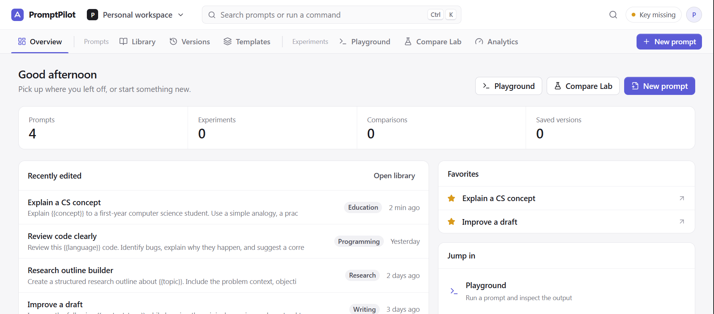
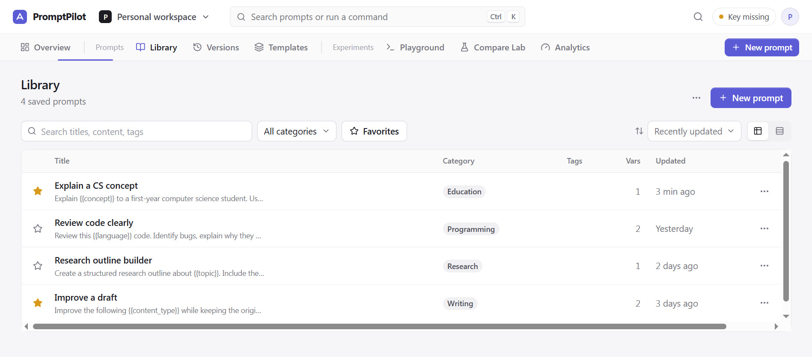
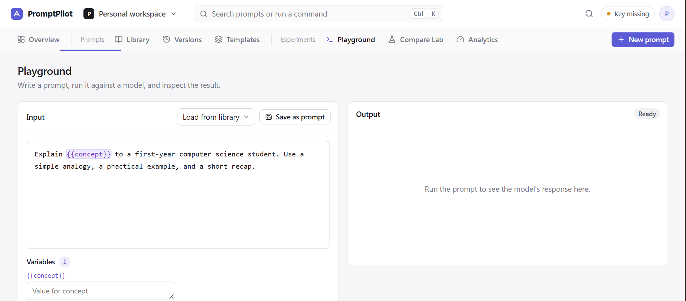
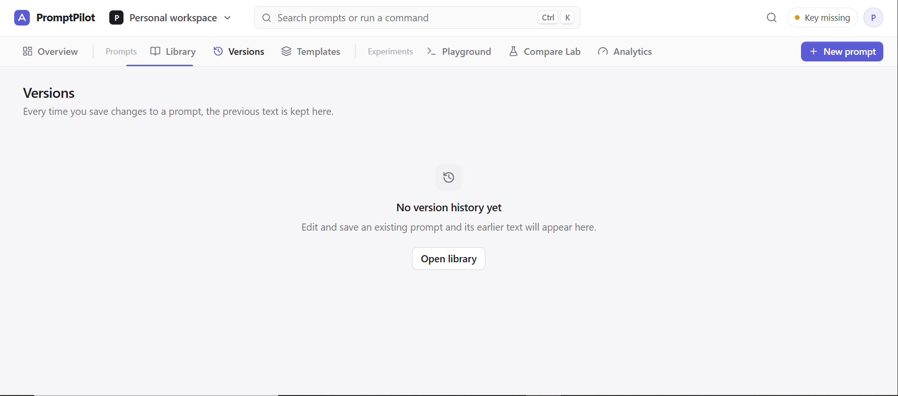
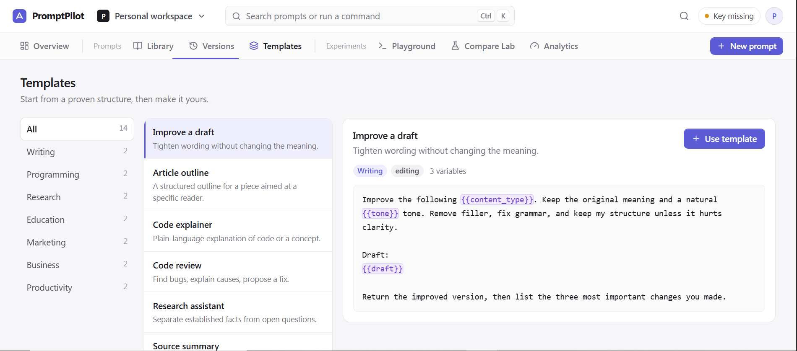
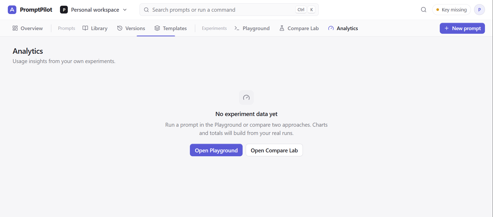

# 🚀 PromptPilot — AI Prompt Engineering Workspace


A **modern, all-in-one AI prompt engineering workspace** designed to help users create, organize, test, compare, and improve prompts across AI models.

PromptPilot brings prompt management, AI experimentation, model comparisons, version tracking, and performance insights together in one organized environment.

With its intuitive Flight Deck Navigation, interactive Playground, and Compare Lab, PromptPilot provides a centralized space for experimenting with prompts and discovering what works best.

---

# 🖥️ Application Preview

<table>
  <tr>
    <td align="center">
      
      <br>
      <b>Workspace Overview</b>
    </td>
    <td align="center">
      
      <br>
      <b>Prompt Library</b>
    </td>
  </tr>
  <tr>
    <td align="center">
      
      <br>
      <b>AI Playground</b>
    </td>
    <td align="center">
      
      <br>
      <b>Compare Lab</b>
    </td>
  </tr>
  <tr>
    <td align="center">
      
      <br>
      <b>Version History</b>
    </td>
    <td align="center">
      
      <br>
      <b>Prompt Templates</b>
    </td>
  </tr>
  <tr>
    <td align="center" colspan="2">
      
      <br>
      <b>Analytics Dashboard</b>
    </td>
  </tr>
</table>

---

# 📌 Overview

Writing effective AI prompts can be challenging, especially when users need to experiment with different instructions, organize multiple prompt versions, and compare generated outputs.

Managing these experiments across separate tools can make the process disorganized and difficult to track.

**PromptPilot was designed to bring these activities into one centralized workspace.**

Users can create and manage reusable prompts, test them through an AI-powered Playground, compare different approaches using Compare Lab, and keep track of previous versions and experiments.

The platform emphasizes an organized and efficient workflow, helping users refine their prompts through experimentation rather than relying on trial and error alone.

PromptPilot is designed for students, developers, researchers, content creators, AI enthusiasts, and anyone who regularly works with generative AI tools.

---

# ✨ Features

- 🚀 **Workspace Overview** — Access important workspace information, recent activity, prompts, and experiments from one centralized dashboard.
- 🧭 **Flight Deck Navigation** — Navigate through PromptPilot using a distinctive horizontal navigation system designed for efficient workflows.
- 📚 **Prompt Library** — Create, organize, search, edit, favorite, and manage reusable AI prompts.
- ✍️ **Prompt Editor** — Write and refine prompts with support for dynamic variables using the `{{variable}}` syntax.
- 🧪 **AI Playground** — Test prompts using supported AI models and review their generated responses.
- ⚖️ **Compare Lab** — Run two prompt approaches or model configurations side by side to compare their outputs.
- 🔄 **Prompt Version History** — Keep track of previous prompt revisions and restore earlier versions.
- 🧩 **Prompt Templates** — Explore reusable prompt templates for different tasks and workflows.
- 📊 **Analytics Dashboard** — Review available experiment statistics, model usage, and execution information.
- 🔤 **Dynamic Variables** — Replace prompt placeholders with custom values before running experiments.
- 🤖 **Gemini Integration** — Connect to Google's Gemini API for AI-powered prompt execution.
- ⏱️ **Execution Tracking** — Review available execution times and experiment results.
- 📋 **Experiment History** — Keep track of previous testing sessions and generated outputs.
- 📤 **Import and Export** — Back up and transfer supported workspace data.
- ⌨️ **Command Palette** — Access important actions and navigation through a keyboard shortcut.
- 💾 **Local Data Persistence** — Preserve supported workspace information through browser-based storage.
- 🔐 **API Key Protection** — Keep Gemini API credentials on the backend instead of exposing them in frontend code.
- 📱 **Responsive Interface** — Designed to provide a usable experience across desktop, tablet, and mobile screen sizes.

---

# 🛠️ Technologies Used

## Frontend Development

- React
- TypeScript
- HTML5
- CSS3
- Vite
- Lucide Icons

## Backend Development

- Node.js
- Express.js
- TypeScript

## Artificial Intelligence Integration

- Google Gemini API
- Google Gen AI SDK

## Development and Build Tools

- npm
- Vite
- Git
- GitHub
- Visual Studio Code

## Data Management

- Browser Local Storage
- JSON-based data import and export
- Backend API communication

---

# 🚀 Installation and Setup

Follow these instructions to install and run PromptPilot locally.

## Prerequisites

Before installing the project, ensure that the following tools are available:

- [Node.js](https://nodejs.org/)
- npm, included with Node.js
- [Git](https://git-scm.com/)
- [Visual Studio Code](https://code.visualstudio.com/)
- A modern web browser
- A Google Gemini API key from [Google AI Studio](https://aistudio.google.com/app/apikey)

## 1. Clone the Repository

```bash
git clone https://github.com/rheillunio2-byte/Prompt-Pilot.git
```

## 2. Navigate to the Project Folder

```bash
cd Prompt-Pilot
```

## 3. Open the Project in Visual Studio Code

```bash
code .
```

Alternatively, open Visual Studio Code manually and select the PromptPilot project folder.

## 4. Install Dependencies

```bash
npm install
```

If you are using Windows PowerShell and encounter an execution-policy error, use:

```powershell
npm.cmd install
```

## 5. Configure Environment Variables

Locate the backend environment example file:

```text
server/.env.example
```

Create a new file named `.env` inside the `server` directory.

Your configuration should follow this format:

```env
GEMINI_API_KEY=your_gemini_api_key_here
GEMINI_MODEL=gemini-2.5-flash
PORT=3001
CLIENT_ORIGIN=http://localhost:5173
```

Replace `your_gemini_api_key_here` with your own API key generated through Google AI Studio.

**Important Security Notes:**

- Never share your API key publicly.
- Never commit your `.env` file to GitHub.
- Do not place API keys inside frontend source code.
- Keep your credentials on the backend.

## 6. Run PromptPilot Locally

Start the development environment:

```bash
npm run dev
```

Alternatively, on Windows PowerShell:

```powershell
npm.cmd run dev
```

## 7. Open PromptPilot in Your Browser

Once the development servers have started, access the application at:

```text
http://localhost:5173/
```

The backend API runs at:

```text
http://localhost:3001/
```

**Note:** Gemini-powered features require a valid API key and an available API quota. Additional configuration may be required depending on the environment.

---

# 📖 How to Use PromptPilot

## 1. Overview

The Overview page provides a centralized workspace where users can review their prompts, recent experiments, and available productivity tools.

Use it to quickly access important sections and continue previous work.

## 2. Prompt Library

The Prompt Library allows users to create and organize reusable prompts.

You can:

- Create new prompts.
- Edit existing prompts.
- Search and organize your collection.
- Mark frequently used prompts as favorites.
- Manage prompt information.
- Export and import supported workspace data.

## 3. Playground

The Playground provides an environment for testing prompts using supported AI models.

A typical workflow includes:

1. Select or write a prompt.
2. Enter the required variable values.
3. Choose an available AI model.
4. Execute the prompt.
5. Review the generated response.
6. Save or reuse the experiment when supported.

## 4. Compare Lab

Compare Lab allows users to evaluate two prompt approaches side by side.

You can experiment with different instructions, prompt variations, or supported model configurations.

Review the generated outputs and available execution information to determine which approach best meets your requirements.

## 5. Versions

The Versions section keeps track of available prompt revisions.

Use it to review previous versions and restore an earlier prompt when necessary.

## 6. Templates

The Templates section provides reusable prompt structures for different tasks.

Templates can help users get started faster without writing every prompt from scratch.

## 7. Analytics

The Analytics section presents available information about prompt experimentation and workspace activity.

Use it to review experiment statistics, model usage, and execution information based on recorded data.

---

# 🔤 Working with Prompt Variables

PromptPilot supports dynamic prompt variables using double curly braces.

Example:

```text
Write a {{content_type}} about {{topic}}.

The target audience is {{audience}}.
Use a {{tone}} tone and keep the response
within {{word_count}} words.
```

Before executing the prompt, provide values for the detected variables.

For example:

| Variable | Value |
|---|---|
| content_type | Blog article |
| topic | Artificial Intelligence |
| audience | College students |
| tone | Conversational |
| word_count | 500 |

The application uses these values to prepare the prompt for execution.

---

# 📂 Project Structure

```text
Prompt-Pilot/
│
├── client/
│   ├── public/
│   │   └── images/
│   │       ├── Analytics.PNG
│   │       ├── Compare Lab.PNG
│   │       ├── Library.PNG
│   │       ├── Overview.PNG
│   │       ├── Playground.PNG
│   │       ├── Templates.PNG
│   │       └── Versions.PNG
│   │
│   └── src/
│
├── server/
│   ├── src/
│   ├── .env.example
│   └── package.json
│
├── .gitignore
├── CONTRIBUTING.md
├── LICENSE
├── package.json
└── README.md
```

*The project structure may vary depending on the current implementation.*

---

# ⚠️ Important Notes

- PromptPilot is an AI prompt engineering workspace and requires a valid API configuration for Gemini-powered functionality.
- API availability, usage limits, and pricing are subject to Google's current Gemini API policies.
- API keys must remain private and should only be configured through backend environment variables.
- Prompt and experiment persistence depends on the application's implemented storage mechanisms.
- Some advanced features and integrations may require additional development.
- Experiment results may vary depending on the selected model, prompt instructions, and generation settings.
- Analytics should be interpreted according to the data actually recorded by the application.

---

# 🔮 Future Improvements

Potential future enhancements include:

- 🤖 Additional AI provider integrations, including OpenAI, Anthropic Claude, Groq, and OpenRouter.
- 📈 Advanced prompt quality evaluation and scoring.
- 🧠 AI-assisted prompt optimization.
- 🧪 Custom evaluation datasets.
- 📊 More detailed experiment analytics.
- ☁️ Cloud synchronization and backup.
- 👥 User accounts and collaborative workspaces.
- 🔐 Secure authentication and user management.
- 🗂️ Advanced prompt organization and tagging.
- 📤 Additional import and export formats.
- 🔌 Custom API provider configurations.
- 🏆 Prompt performance benchmarking.

These are potential improvements and may not be available in the current version.

---

# 🤝 Contributing

Contributions, suggestions, bug reports, and documentation improvements are welcome.

Please read [CONTRIBUTING.md](./CONTRIBUTING.md) for guidelines on setting up the development environment, following coding standards, reporting bugs, and submitting pull requests.

---

# 📄 License

PromptPilot is distributed under the **MIT License**.

See the [MIT License](https://github.com/rheillunio2-byte/Prompt-Pilot?tab=MIT-1-ov-file) for details.

---

# 👨‍💻 Developer

**Rheil Evans T. Lunio**

GitHub: [@rheillunio2-byte](https://github.com/rheillunio2-byte)

Repository: [PromptPilot](https://github.com/rheillunio2-byte/Prompt-Pilot)

---

**PromptPilot — Write better prompts. Test different models. Find what works.**